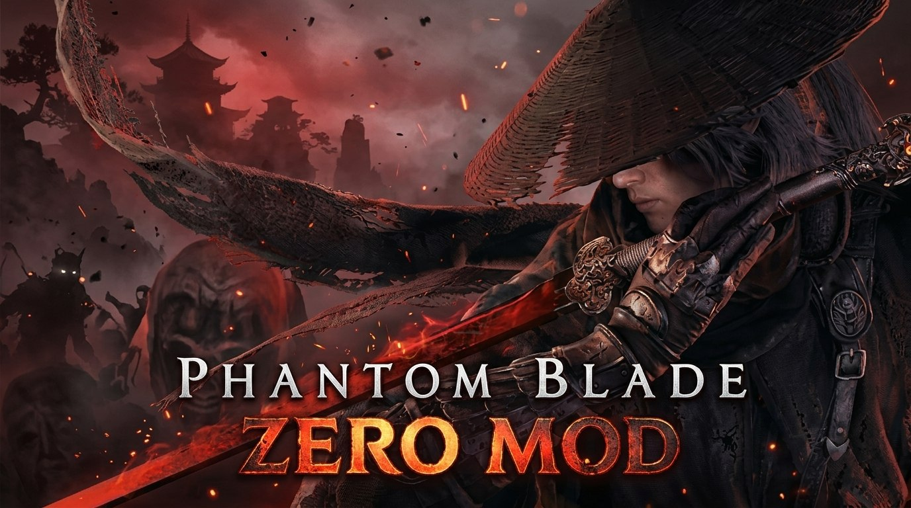

# ⚔️ Phantom Blade Zero: Ultimate QoL & Customization Mod

  

  

  
  
  
  

  <b>⬇ DOWNLOAD THE MOD ⬇</b>

  

  
  

  

> ⚔️ Your complete toolkit for Phantom Blade Zero — customize your HUD, edit your build on the fly, and explore the world with improved visibility. Designed for single-player offline play. 🛡️ Single-Player Only — no competitive multiplayer, zero ban risk.

## 📖 About the Game

Phantom Blade Zero is a highly anticipated Wuxia action RPG developed by S-GAME and powered by Unreal Engine 5. The game launched on October 29, 2026 for PlayStation 5 and PC via Steam and Epic Games Store .

You play as Soul, a warrior who has only 66 days left to live after a fateful duel leaves him with an enchanted heart. You must fend off assassins, unravel world-ending conspiracies, and defend your values with your life. The game features a fusion of classic Wuxia storytelling with exhilarating, fast-paced combat .

Key Game Features:
- ⚔️ Wuxia Action Combat — Fast-paced swordplay with parries, dodges, and the Sha-Chi (杀气) resource system 
- 🎭 Deep Progression — 30+ main weapons, Phantom Edges, and skill trees 
- 🌍 Unreal Engine 5 — Stunning visuals with reworked environments and character models 
- 🩸 Hardcore Difficulty — Resource management for Sha-Chi and Dark Source 

## ⚠️ IMPORTANT WARNING — READ BEFORE USING

Phantom Blade Zero is a single-player game with no competitive multiplayer.

| Enforcement Risk | Details |
|------------------|---------|
| Single-Player Safe | No anti-cheat system for offline play |
| Engine-Level Mods | Built using UE4SS and UE5 modding tools — no memory injection  |
| Ban Risk | ZERO in single-player — no online competitive modes |

> ⚠️ Important: The game has no anti-cheat. Mods are designed for client-side customization — no game files are permanently changed. Always back up saves before installing mods.

## 🔒 Safety & Security

| Safety Feature | Description |
|----------------|-------------|
| Single-Player Focused | Designed for offline campaigns and personal play |
| UE4SS Framework | Uses the community-standard UE4SS mod loader for Unreal Engine games |
| No Network Code | Mods contain no telemetry or online hooks |
| BackupRecommended | Always back up saves before installing mods |

> ⚠️ Important: The mod uses UE4SS (Unreal Engine 4/5 Scripting System) to load custom Lua scripts. This is the standard modding method for UE5 games. Save location: Steam\steamapps\common\PBZ\ProjectPBZ\Saved\SaveGames.

## 🔥 Featured Mods & Scripts

### 🎮 PBZ Tuner (Gameplay Customization)

Source: Nexus Mods | Version: Latest | Updated: October 2026 

A flexible customization mod that lets you adjust gameplay parameters through a web page or text file.

Features:
- Enemy Stats — Adjust health and damage of enemies
- Player Stats — Modify Soul's Sha-Chi, health, and other attributes
- Parry Window — Adjust the timing window for perfect deflects
- Ultimate Charge — Modify ultimate ability charge rate
- Easy Apply — Press F5 in-game to apply changes, F7 to reset to default 

Installation:
1. Download the mod from Nexus Mods.
2. Extract to the game folder.
3. Configure via the web interface or text file.
4. Press F5 in-game to apply.

### 🎮 3DM QoL Script (49 Features)

Source: 3DM | Version: v301524-17219 | Size: 130KB | Updated: October 30, 2026 

A comprehensive script with 49 features focused on testing and customization.

Features:
- Combat Testing: Auto Parry, Auto Dodge, Damage Multiplier, One Hit Kill, One Hit Break 
- Resource Management: Infinite Sha-Chi, Infinite Pure Sha-Chi, Infinite Potions, Infinite Dark Source 
- Progression: Obtain All Weapons, Max All Weapon Levels, Max All Potion Levels, Edit Consciousness Dust 
- Utility: Flight Mode, No Clip, Teleport, Game Speed, Remaining Days Editor 
- Item Spawner: Dynamic item catalog with icons, category search, safe item addition 

Creator: tkwlee@3DMGAME

Installation:
1. Save and exit the game properly.
2. Extract the ZIP archive.
3. Copy version.dll, version.ini, and the scripts folder to PBZ/platform/steam/ (where PBZ.exe is located) 
4. Launch the game and press Insert to open the menu 

### 🎮 FLiNG Customization Script (28 Features)

Source: 游侠网 | Version: CL-301524_JKS-17219 | Updated: October 29, 2026

A clean, intuitive script with 28 features and deep stat editing.

Features:
- Quick Toggles: Lock Health, Lock Sha-Chi, Lock Ultimate Charge, Instant Refill
- Multipliers: Attack Multiplier, Movement Multiplier, Sha-Chi Attack/Recovery Multiplier
- Stat Editing (28 fields): Health, Shield, Sha-Chi, Attack, Status Effects, Movement Speed

### 🛠️ Community Mods (Nexus Mods)

Several community mods are available for different playstyles :

| Mod | Description |
|-----|-------------|
| Bellbound: Enemies Respawn | Enemies respawn at checkpoints (Soulslike style)  |
| Boss Phase Reset | Boss fights reset to phase 1 on death  |
| Style Rank | Devil May Cry-style combat ranking (D to SSS)  |
| DLSS 5 Mod | Adds NVIDIA DLSS 5 support via ReShade |
| 66 Days Unlocked | Unlocks max difficulty from the start  |

## 🎮 Quick Access Keybinds

| Key | Action | Key | Action |
|-----|--------|-----|--------|
| Insert | Open 3DM Menu | F5 | Apply Tuner Changes  |
| F7 | Reset Tuner to Default  | — | — |

## 🚀 Installation

> ⚡ Quick & Easy — takes less than 1 minute!

### Method 1 — 3DM QoL Script (Recommended)

1. Download the archive from the button above .
2. Save and exit the game properly.
3. Extract the ZIP archive.
4. Copy version.dll, version.ini, and the scripts folder to PBZ/platform/steam/ .
5. Launch the game and press Insert to open the menu .

### Method 2 — PBZ Tuner

1. Download the mod from Nexus Mods .
2. Extract to the game folder.
3. Configure via the web interface.
4. Press F5 in-game to apply changes .

### Method 3 — Community Mods (Nexus Mods)

1. Download the desired mod from Nexus Mods .
2. Extract the .zip toSteam\steamapps\common\PBZ\ProjectPBZ\Content\Paks\~mods .
3. Create the ~mods folder if it doesn't exist .
4. Launch the game.

> ⚠️ Antivirus warning? This is a false positive because the tool reads game memory. Add the file to your exceptions list.

### 📁 Folder Structure
### ⚠️ Important Notes
- Backup your saves before installing any mod .
- Admin rights are required for full functionality.
- Works with Steam and Epic Games Store versions .
- Compatible with game version CL-301524 .
- Single-player only — no multiplayer.
- Add the tool folder to antivirus exclusions to prevent false positives.

## ❓ FAQ

### ❓ Is this a crack or pirate version?
No. This is a client-side customization mod. It modifies game values in real-time but does not bypass game licensing. You still need to own the game.

### ❓ Will I get banned?
No. Phantom Blade Zero is a single-player game with no anti-cheat system. Use it freely in offline mode.

### ❓ Does this work with the latest game patch?
Yes. The mods are updated for game version CL-301524 (October 29, 2026) .

### ❓ Does it work on Windows 11?
Yes. Fully compatible with Windows 10 and 11 (64-bit).

### ❓ Can I save my settings?
Yes. The config system allows unlimited presets.

### ❓ How to uninstall?
Delete the scripts/GlossTrainer.asi file. Only remove version.dll and version.ini if they are not used by other plugins .

### ❓ What if the mod doesn't work?
- Run both game and script as administrator.
- Add tool folder to antivirus exclusions.
- Try launching the script before the game.
- Check game version matches script version.

### ❓ What is Sha-Chi?
Sha-Chi (杀气) is a combat resource used for special abilities and heavy attacks. It functions similarly to a stamina bar . Mods can lock it at maximum, allowing unlimited skill usage .

### ❓ What is Consciousness Dust?
Consciousness Dust is a premium currency used for upgrades. The 3DM script allows you to edit this value . Use it carefully.

## 🛠️ System Requirements

| Component | Minimum | Recommended |
|-----------|---------|-------------|
| OS | Windows 10 (64-bit) | Windows 11 (64-bit) |
| Processor | Intel Core i7-8700K / AMD Ryzen 5 3600  | Intel Core i5-10600K / AMD Ryzen 5 5600X  |
| RAM | 16 GB  | 16 GB  |
| GPU | NVIDIA GTX 1660 6GB / AMD RX 5500 XT 8GB  | NVIDIA RTX 3060 Ti / AMD RX 6700 XT  |
| Storage | 145 GB (game) + 100 MB (mod)  | 145 GB SSD (game) + 100 MB (mod) |
| Admin Rights | Required | Required |

## 📢 Disclaimer

> Fan-made mod collection. Not affiliated with Phantom Blade Zero developers, S-GAME, or any publisher.
>
> Use at your own risk. The author is not responsible for save corruption, crashes, or damage.
>
> Single-player only — use freely in offline mode.
>
> Back up your saves before use!

## 🌟 Support This Project

- ⭐ Star this repository
- 🔔 Watch for updates
- 🐞 Report issues
- 💬 Share with friends!

© 2026 • Phantom Blade Zero • Master the Wuxia
